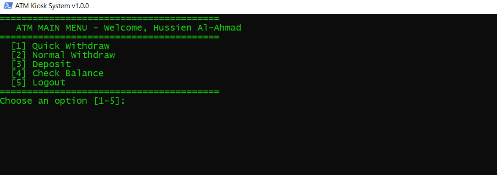
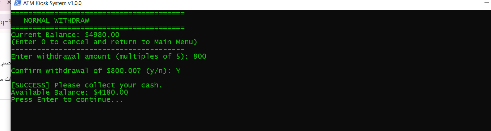
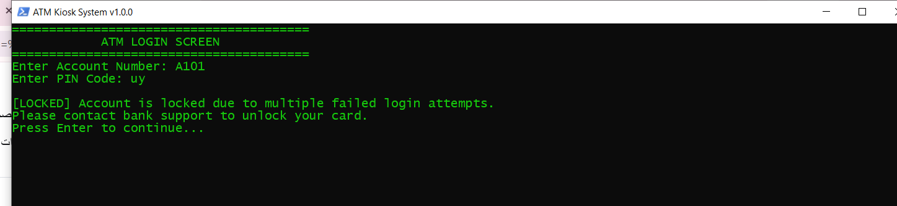

# ATM Kiosk System (v1.0.0)

`C++11` • `Procedural MVC` • `Pitchfork Layout (PFL)` • `-Wall -Wextra -Werror -Wconversion`

A production-grade, fault-tolerant Automated Teller Machine (ATM) terminal system engineered in strict **C++11**. Built from the ground up following the **Pitchfork Layout (PFL)** and **Procedural MVC** architecture—enforcing **Zero OOP**, **Zero Global State**, and **Zero Mutual Recursion**.

---

## Live Terminal Preview

### 1. Authenticated Main Menu


### 2. Atomic Cash Withdrawal & Instant Balance Sync


### 3. Persistent 3-Strike Security Card Lockout


---
---

## Key Engineering & Security Highlights

* **Atomic Crash-Safe Persistence (`Commit-Before-Mutate`):** All balance updates and lockout states are written to an isolated `.tmp` file via RAII streams and atomically swapped onto disk before mutating in-memory session state. Power loss mid-write cannot corrupt client records.
* **Constant-Time PIN Verification & Anti-Enumeration:** Mitigates timing side-channel leaks using bitwise `XOR` accumulation across credential bytes, paired with unified strike counters and persistent 3-strike card lockout.
* **IEEE-754 Financial Precision:** Guards monetary comparisons and zero-flooring with an explicit `EPSILON` (`1e-6`) threshold to eliminate binary floating-point drift.
* **Constant-Stack Event Loops (`O(1)` Auxiliary Stack):** Replaces recursive menu navigation with deterministic `while` dispatchers and strongly-typed `enum class` options, preventing stack overflow across unbounded kiosk uptime.
* **Hardened Stream & Terminal I/O:** Resilient against `std::cin` corruption, `NaN`/`Inf` injections, and unsafe shell calls (`system("cls")` replaced by portable ANSI escape sequences with native Win32 Virtual Terminal support).
* **Memory-Aligned POD Models & `O(L)` Streaming Lookup:** Struct fields are ordered by descending size to minimize 64-bit padding, while single-account lookups stream line-by-line in `O(L)` space without loading the entire database into RAM.

---

## Project Structure (Pitchfork Layout)

```text
atm-system/
├── data/
│   └── .gitkeep                      # Auto-bootstrapped seed storage directory
├── include/
│   ├── controllers/
│   │   ├── atm_controller.h          # Authenticated session & transaction orchestration
│   │   └── auth_controller.h         # Login flow & 3-strike lockout policy
│   ├── models/
│   │   ├── client.h                  # Memory-aligned POD Client struct
│   │   └── client_repository.h       # Streaming lookup & atomic file persistence
│   ├── utils/
│   │   ├── input_utils.h             # Stream-safe, iterative console input validators
│   │   └── string_utils.h            # Linear O(N) string tokenization & formatting
│   └── views/
│       ├── atm_view.h                # Dumb UI screens & strongly-typed MenuOption
│       └── auth_view.h               # Dumb authentication terminal prompts
├── src/
│   ├── controllers/
│   │   ├── atm_controller.cpp
│   │   └── auth_controller.cpp
│   ├── models/
│   │   └── client_repository.cpp
│   ├── utils/
│   │   ├── input_utils.cpp
│   │   └── string_utils.cpp
│   ├── views/
│   │   ├── atm_view.cpp
│   │   └── auth_view.cpp
│   └── main.cpp                      # Kiosk bootstrap & iterative session loop
└── tests/
    └── test_main.cpp                 # Isolated cassert unit test suite
```

---

## Build & Run Instructions

### Prerequisites
* **Compiler:** GCC / MinGW-w64 (`g++`) with C++11 support.
* **Flags Enforced:** `-std=c++11 -Wall -Wextra -Werror -Wconversion`

### 1. Run Automated Unit Tests
PowerShell (Windows):
```powershell
New-Item -ItemType Directory -Force -Path bin | Out-Null
\$libFiles = (Get-ChildItem -Path src -Recurse -Filter "*.cpp" | Where-Object { \$_.Name -ne "main.cpp" }).FullName
g++ -std=c++11 -Wall -Wextra -Werror -Wconversion -Iinclude \$libFiles tests/test_main.cpp -o bin/run_tests.exe
.\bin\run_tests.exe
```

### 2. Build & Launch Live ATM Kiosk
PowerShell (Windows):
```powershell
New-Item -ItemType Directory -Force -Path bin, data | Out-Null
\$srcFiles = (Get-ChildItem -Path src -Recurse -Filter "*.cpp").FullName
g++ -std=c++11 -Wall -Wextra -Werror -Wconversion -Iinclude \$srcFiles -o bin/atm_system.exe
.\bin\atm_system.exe
```

*(Note: On first launch, `ensureSeedData` automatically generates sample accounts inside `data/clients.txt` if none exist).*

---

## Engineering Standards Enforced
* **Algorithmic Documentation:** Every implementation function documents explicit `Time O(...)` and `Space O(...)` bounds.
* **Strict Type Safety:** Zero implicit narrowing conversions (`-Wconversion` treated as hard error).
* **Git Workflow:** Feature-branch isolation merged via `--no-ff` with strict **Conventional Commits**.

---

## Author
**Hussien** ([@Hussien3204](https://github.com))  
Repository: [https://github.com/atm-system](https://github.com/atm-system)
